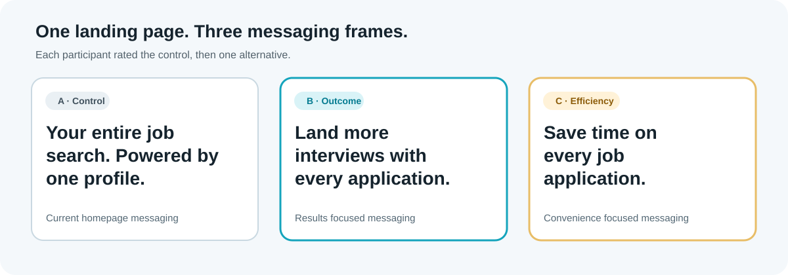
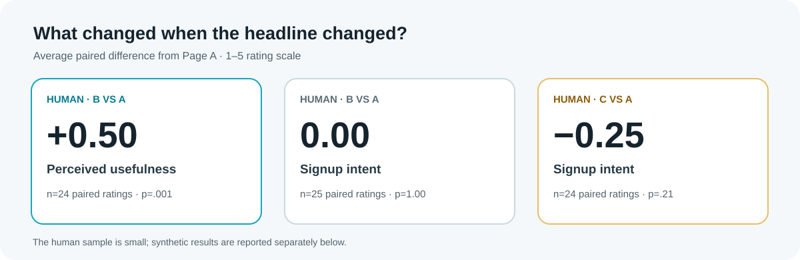

# Simplify landing page messaging experiment

**Can a homepage headline make students more interested in Simplify?** We compared Simplify's current headline with two alternatives: one promising more interviews and one emphasizing time saved. In a survey of 49 Carnegie Mellon University graduate students, the interview-focused headline increased **perceived usefulness by 0.50 points** on a five-point scale (paired test, p=.001), but **did not increase stated signup intent**.

This is a CMU A/B Testing course project by **Jennifer Liu, Yiying Lu, and Susana Peng** (Spring 2026). The study used mock landing pages and survey ratings; it was not a live website experiment.

## The experiment



| Page | Role | Headline |
| --- | --- | --- |
| **A** | Control | “Your entire job search. Powered by one profile.” |
| **B** | Outcome focused | “Land more interviews with every application.” |
| **C** | Efficiency focused | “Save time on every job application.” |

Participants were assigned to **AB** (25 people, A then B) or **AC** (24 people, A then C) using block randomization in Qualtrics. Each person rated both pages they saw on signup intent, perceived usefulness, likely regular use, and likelihood to recommend, each on a 1–5 scale. The analysis compares each treatment with that respondent's Page A rating. B and C were shown to different people, so they were not directly compared within the same respondent.

## Key findings



The table below uses **human responses only**. Values are average paired changes from Page A; positive values mean the alternative scored higher.

| Outcome | B vs A (AB group) | C vs A (AC group) |
| --- | ---: | ---: |
| **Perceived usefulness** | **+0.50 (p=.001; n=24)** | +0.05 (p=.80; n=22) |
| Signup intent | 0.00 (p=1.00; n=25) | −0.25 (p=.21; n=24) |
| Likely regular use | +0.24 (p=.21; n=25) | −0.13 (p=.50; n=24) |
| Likelihood to recommend | +0.12 (p=.50; n=25) | −0.17 (p=.46; n=24) |

The clearest observed effect is that **B made the product seem more useful**. The human survey did not establish a signup lift for B or a statistically significant decline for C. The smaller n for usefulness reflects missing paired ratings. The underlying estimates, standard errors, and confidence intervals are in [`ate_results.csv`](Project/data/ate_results.csv).

### Synthetic extension

The team also generated **1,056 synthetic respondents** with a professor-provided profiling library and Claude, preserving the human sample's demographic distribution: 533 in AB and 523 in AC. These responses were analyzed separately from the human data. In the synthetic sample, C lowered signup intent by **0.41 points** versus A (p<.001). The combined sample of 1,105 people shows a **0.40-point** decline (p<.001), but this combined estimate is dominated by synthetic responses. It should not be treated as an independent replication with real users.

**Recommendation:** Prioritize the outcome-focused headline for a larger, live test. It improved perceived usefulness in the human survey; a real signup or click-through experiment is needed before claiming it improves conversion.

## Repository guide

| Path | What it contains |
| --- | --- |
| [`Project/01_data_prep.py`](Project/01_data_prep.py) | Cleans the original Qualtrics export into human wide and long datasets. |
| [`Project/02_gen_llm_data.py`](Project/02_gen_llm_data.py) | Builds prompts and generates or validates synthetic responses. |
| [`Project/03_analysis.py`](Project/03_analysis.py) | Computes summary statistics, balance checks, paired treatment effects, subgroup analyses, regressions, and power calculations. |
| [`Project/data/`](Project/data) | Saved cleaned datasets, prompts, and result tables. |
| [`Project/ABT_Proposal.docx`](Project/ABT_Proposal.docx) | Original proposal. The final survey design above supersedes its initial two-page plan. |

The saved datasets let you inspect the reported analysis without recreating the survey or synthetic generation. To rerun the analysis from those files, install `pandas`, `numpy`, `scipy`, and `statsmodels`, then run:

```bash
python Project/03_analysis.py
```

The preparation and synthetic-generation scripts use local file paths and an external course library that are not included in this repository. They need those inputs and paths configured before they can be rerun elsewhere.

## Branch guide

This repository has three branches. **[`main`](../../tree/main)** is the assembled project and the source for the final results above.

| Branch | Purpose and relationship to `main` |
| --- | --- |
| [`ATE_analysis_yiying`](../../tree/ATE_analysis_yiying) | Separate analysis branch with an additional [slides analysis notebook](../../blob/ATE_analysis_yiying/Project/slides_analysis.ipynb). It has a commit that is not in `main`, so consult the notebook there. |
| [`Susana_analysis`](../../tree/Susana_analysis) | Earlier analysis snapshot. It is seven commits behind `main` and contains an earlier, smaller synthetic dataset; use `main` for final sample sizes and findings. |

## Scope and limitations

- The human sample is small (49 graduate students from one university), and some outcomes have fewer complete pairs.
- Every participant saw A first, so order effects cannot be ruled out.
- Ratings describe **stated intentions**, not actual signups.
- Synthetic respondents help explore the analysis but cannot replace evidence from real users.

The treatment estimates and sample counts above match the saved [ATE results](Project/data/ate_results.csv) and the team's final presentation.